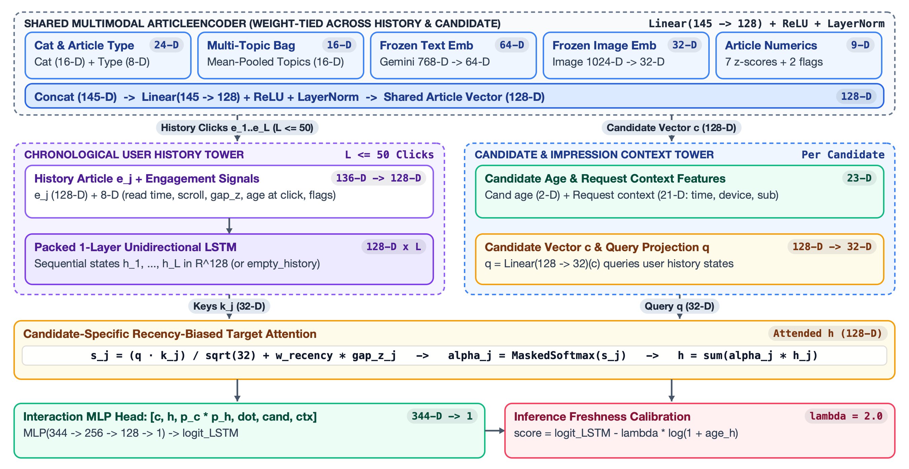

# 2.1 LSTM with target-aware attention

**Owner:** Winston Ho Rui Wei. The initial tuned run
`20261104_014914_seed42` completed training, all-request exports and the persistent
reload check. Its full-validation known-click Recall@100 was **76.50%** across
29,110 requests. These are development results, not final holdout performance.

The model learns personal click relevance from recorded slates, then scores every
eligible article. The working shortlist is the first 100 ranked articles; the
next 100 are retained as a buffer. The separate business reranker produces the
final five recommendations. Unshown article outcomes remain unknown.

## Notebook sequence

The numbering identifies stages within the `2.1_lstm` experiment family. Run IDs,
helper-module names and persistent artifact locations remain unchanged.

| Notebook | Purpose and status |
| --- | --- |
| [2.1.1 Initial LSTM run](2.1.1_initial_run.ipynb) | Completed tuned experiment, all-request prediction exports and reload evidence. |
| [2.1.2 LSTM ablation study](2.1.2_ablation_study.ipynb) | Completed component comparisons, baselines and freshness blending, with saved outputs. |
| [2.1.3 Improved LSTM run](2.1.3_improved_run.ipynb) | Completed: one LSTM, joint checkpoint/freshness selection on 2,000 requests, all-request exports and saved-model reload; validation Recall@100 91.61%. |
| [2.1.4 Model explainability](2.1.4_explainability.ipynb) | Completed: 200 fixed validation requests, 1,724 explanation pairs, attention and freshness examples, input sensitivity and persistent report reload; findings included. |
| [2.1.5 LSTM depth experiment](2.1.5_depth_experiment.ipynb) | Unexecuted Colab experiment: freshly trained one-layer versus two-layer controls, matched seeds, fixed epoch budgets, separate selection/reporting requests, raw and freshness-adjusted metrics, and paired user-bootstrap comparisons. |

For explainability, upload `lstm_explainability_helpers.zip` to a fresh Colab
GPU / High RAM runtime and run `2.1.4_explainability.ipynb`. Original training
helpers are loaded from the saved final bundle. Reports are written to the
separate `2.1.4_explainability/<run_id>/` shared folder; evaluator exports remain
unchanged. See the [shared explanation protocol](../explainability/README.md).

The improved notebook follows one end-to-end path: load the shared SMALL
catalogue, fit and select the model, export all splits, and reload the saved
score. Train, validation and test use the same 20,738 article IDs with the
shared publication-time eligibility rule.

The improved run's completed training export covers all 232,887 requests and
46,577,400 retained score rows. Training Recall@100 is 94.67% and observed-click
nDCG@100 is 0.3392; these are in-sample fit diagnostics. Rankings are saved under
`rankings/train/submission_top_200.parquet`, with metrics in
`evaluation/training_export.json` in the existing improved-run folder.

## Neural Architecture and Formulation

The neural sequential ranker (`TargetAwareLSTMRanker` in `lstm_model.py`) models chronological reader consumption patterns and predicts candidate relevance through candidate-queried attention over user history states.



### Multimodal Article Encoder (145-D to 128-D)
The `ArticleEncoder` processes candidate articles and historical click items through parallel modality-specific projection layers:
- Category embedding: 16-D learned representation over 26 categorical codes (`nn.Embedding(26, 16, padding_idx=0)`).
- Article type embedding: 8-D learned representation over 15 structural type codes (`nn.Embedding(15, 8, padding_idx=0)`).
- Topic bag representation: 16-D mean-pooled embedding bag over 80 topic codes (`nn.Embedding(80, 16, padding_idx=0)`).
- Gemini text projection: 64-D linear projection (`nn.Linear(768, 64)`) applied to frozen 768-D `gemini-embedding-2` document vectors. A 20% training-only modality dropout regularizes the projection against missing text embeddings in the candidate catalogue.
- EB-NeRD ResNet image projection: 32-D linear projection (`nn.Linear(1024, 32)`) applied to frozen 1024-D visual embeddings.
- Dense numeric statistics: 9-D standardized features covering body word counts, title lengths, sentiment scores, premium status, and missingness availability flags.

The concatenated 145-D multimodal representation (16 + 8 + 16 + 64 + 32 + 9 = 145) is projected through a dense layer with ReLU activation and Layer Normalization (`nn.Sequential(Linear(145, 128), ReLU(), LayerNorm(128))`) to yield a unified 128-D article embedding.

### Sequential History Encoder
The user interaction sequence retains up to 50 chronological reading events. Each historical click event concatenates the 128-D article embedding with 8-D event interaction features (dwell read time, scroll percentage, and time interval to request), forming a 136-D event representation projected to 128-D via an input linear transformation with ReLU and dropout (`nn.Sequential(Linear(136, 128), ReLU(), Dropout(0.2))`). A recurrent network (`nn.LSTM(128, 128, batch_first=True)`) processes the chronological sequence via packed sequences, generating output hidden states $H = [h_1, h_2, \dots, h_L] \in \mathbb{R}^{L \times 128}$.

### Recency-Biased Query-Key Attention
The candidate article embedding $c \in \mathbb{R}^{128}$ queries the sequence of historical hidden states. Learned projections map candidate vectors to a 64-D query space ($q = W_q c \in \mathbb{R}^{64}$) and hidden states to 64-D keys ($k_t = W_k h_t \in \mathbb{R}^{64}$). Scaled dot-product attention scores include an additive recency bias based on standardized log elapsed time $\Delta t_{\text{norm}}$ between each historical interaction and the request timestamp:

$$\alpha_t = \text{softmax}\left(\frac{q^\top k_t}{\sqrt{64}} + w_{\text{rec}} \cdot \Delta t_{\text{norm}}\right)$$

where $w_{\text{rec}}$ is a learnable scalar parameter initialized to -0.5, and $\Delta t_{\text{norm}} = (\ln(1 + \Delta t_{\text{hours}}) - \mu_{\Delta t}) / \sigma_{\Delta t}$ normalizes elapsed interaction hours. The candidate-specific history context vector is pooled as:

$$c_{\text{hist}} = \sum_{t=1}^L \alpha_t h_t \in \mathbb{R}^{128}$$

Users without prior history receive a learned default representation vector $h_0 \in \mathbb{R}^{128}$.

### Interaction Prediction Head (344-D)
To capture both bilinear matching and nonlinear interactions, candidate embedding $c$ and history context $c_{\text{hist}}$ are projected to a 64-D interaction space ($p_c = W_c c, p_h = W_h c_{\text{hist}}$). The model constructs a 344-D feature vector concatenating:
- Candidate article representation: 128-D
- Attended history context vector: 128-D
- Element-wise interaction product ($p_c \odot p_h$): 64-D
- Scaled bilinear dot product ($(p_c^\top p_h) / \sqrt{64}$): 1-D
- Candidate tabular features: 2-D (publication age and freshness flags)
- Request context features: 21-D (user device type, hour of day, day of week, session counters)

Total vector width is 128 + 128 + 64 + 1 + 2 + 21 = 344-D. This concatenated vector passes through a multi-layer perceptron (`Linear(344, 256) -> ReLU() -> Dropout(0.2) -> Linear(256, 128) -> ReLU() -> Dropout(0.2) -> Linear(128, 1)`) to compute the relevance logit $\text{logit}(u, c)$.

### Soft Freshness Decay
To prevent historical popularity bias from promoting stale articles over breaking news, a logarithmic freshness penalty is applied during catalogue scoring:

$$s(u, c) = \text{logit}(u, c) - \lambda \ln(1 + \Delta t_{\text{hours}}), \quad \lambda = 2.0$$

where $\Delta t_{\text{hours}}$ denotes article age in hours from publication to request time. The decay weight $\lambda = 2.0$ was selected via grid search on 2,000 validation requests to maximize Recall@100 across the full 20,738 article candidate pool.

## Model and course connection

The course Week 8 concepts are chronological LSTM history encoding, embeddings
and candidate-specific attention. Each reader's fixed pre-period history retains
its latest 50 events in chronological order, with masked padding. Each candidate
queries the LSTM states; an MLP combines the resulting history representation,
article features, candidate age and pre-request context to produce a click logit.

The rating-regression recipe becomes binary click prediction: BCE on logits fits
clicked = 1 and shown but unclicked = 0 within each original recorded slate.
There are no catalogue-wide negative labels. Frozen text/image vectors are
projected alongside metadata embeddings and train-standardised numeric features.
Missing vectors use zero placeholders plus explicit availability flags, and 20%
training-only candidate text dropout teaches this fallback. Missing vectors never
exclude an otherwise eligible article. Fitted transformations use training
requests/history only and are reused unchanged at inference.

## Reproduce the initial run

1. Open `2.1.1_initial_run.ipynb` in a Colab L4 GPU runtime.
2. Upload `lstm_helpers.zip` to `/content`. It contains `lstm_data.py`,
   `lstm_model.py` and `lstm_inference.py`. Locally, keep the three helpers beside
   the notebook and use that working directory.
3. Add the shared Drive folder shortcut at
   `/content/drive/MyDrive/Colab Notebooks/BT4222 Shared Final Folder`.
   This is `DATA_ROOT`; local execution can set it to the local shared-data copy.
4. Run the cells in order. Setup mounts Drive, imports the uploaded helpers and
   installs DuckDB/Optuna if missing. It uses the runtime's core scientific stack.

The 26-cell notebook follows the nine shared experiment sections. Its single
path is **Optuna -> apply winning parameters -> fit on all training requests ->
restore the selected checkpoint -> export all three splits -> reload from the
persistent copy**. No Git checkout or credentials are required.

| Stage | Declared budget and scope |
| --- | --- |
| Optuna | Up to 12 trials, three epochs/trial, at most 60,000 complete training requests/epoch; 150-minute timeout checked between trials, so an active trial can finish later. |
| Trial selection | Same fixed 100 validation requests, seed 42, with the complete eligible catalogue for each request. Every model/data-order trial seed is 42. |
| Final fitting | All recorded training requests each epoch; up to eight epochs, patience two, batch size 256, AMP on CUDA. |
| Export | All requests in train, validation and test; every eligible article scored in chunks of 32,768, retaining a running top 200. |

Optuna uses seeded TPE and a median pruner (three startup trials, one warmup step).
Its search space is LSTM hidden size `{64,128,256}`, attention size `{32,64,128}`,
article size `{64,128}`, dropout `0.1-0.4`, learning rate `3e-4-3e-3` (log), weight
decay `1e-6-1e-3` (log), and history dropout `0-0.3`. All seven winning settings
are applied before final fitting. Exact eligible-pair counts, retained-output
size estimates and available space are printed before training; export progress
reports elapsed time and an ETA. In the completed L4 run, final training took
about three minutes and catalogue scoring/export took about 67 minutes.

## Ablation study

`2.1.2_ablation_study.ipynb` retains the completed comparisons and their saved
outputs. It covers recency baselines, history encoding, attention, article
representations, seed variation and freshness blending. To reproduce comparisons, upload
`ablation_variants.py` alongside the two main helpers and run setup before the
experiment sections. The initial model's hyperparameters and preprocessing are
reused; trained controls receive a common four-epoch budget.

The reporting sample contains 5,000 validation requests and excludes the 2,000
reserved selection requests. The freshness weight is selected on the latter
sample. The project holdout remains unused. This sample supports within-study
comparisons; it does not replace the all-request handoff below.

In a fresh CPU runtime, Section 13 reloads all saved metrics, including blend
results, without helpers or model execution. Sections 14 and 15 then reload the
saved segment and coverage reports. These tables average available seeds and
identify them explicitly. The original paired comparison outputs remain in the
notebook; the compact summary does not recompute confidence intervals.

## Inputs, catalogue and selection

The following input and catalogue conventions are shared by the initial and
improved runs. The 100-request selection description refers to the completed
initial run; the improved run uses 2,000 requests as described below.

Inputs live under `DATA_ROOT`:

- `feature_engineering/{split}_features.parquet`: existing recorded candidate
  rows, labels and pre-request context; no re-explosion of those rows.
- `feature_engineering/feature_vocabulary.json`: shared feature/category vocabulary.
- `train_val/{train,validation}/history.parquet` and `test/history.parquet`: fixed
  pre-period histories with article/time/read-time/scroll fields.
- `train_val/articles.parquet`, then `test/articles.parquet`: ordered metadata union.
- `embeddings/{train_val,test}/{text,image}_embeddings.parquet`: frozen vectors;
  the supplied `{train_val,test}/article embeddings/` layout is also accepted.
- Original behaviour Parquets, when present, are cross-checked against the feature
  candidates, labels and composite request keys.

The path helper supports the shared folder layouts and supplied `loader_paths.json`.
For nullable fixed-size-vector Parquets affected by the known PyArrow read error,
it uses DuckDB's reader while preserving dimensions, row order, IDs and nulls.

All splits use `published_at_or_before_request_v1`: the ordered union of train_val
then test, keeping the first article/vector source record, including missing
values. Known publication time must be at or before the request time, compared
in microseconds. There is no age/access cutoff or embedding-coverage filter.
Catalogue features use only metadata, prior history and pre-request context;
recorded slate size, pool-relative ranks and future article totals are excluded.

`behaviour_id = "user_id:impression_id"` uses exact original integer IDs. The
selection sample is the smallest 100 `(BLAKE2b-64("42:validation:behaviour_id"),
behaviour_id)` priorities from the complete validation population, processed in
(timestamp, user_id, impression_id) order, matching the 3.1 sampling rule.
Only checkpoint/trial selection uses this sample; final fitting and exports use
all recorded requests.

Selection maximises macro **known-click Recall@100**, then **observed-click
nDCG@100**, then preserves the earlier checkpoint/trial. Recorded-slate mean
impression AUC is diagnostic. Final export reports the selected model on full
validation at both K=100 and K=200; export size does not change the selection
objective. Recall denominators and nDCG ideals retain all original known clicks,
including missed/ineligible clicks. Unshown articles' zero observed gain is
retrieval bookkeeping, not a non-click label. Validation is repeatedly used
**development** data. Project test labels are kept on disk for final evaluation and masked during development.

## Improved run: single LSTM with tuned freshness

`2.1.3_improved_run.ipynb` runs on an **A100 GPU with High RAM**. Upload
[`lstm_helpers.zip`](lstm_helpers.zip) to the Colab runtime, open the notebook and
run the cells in order. The notebook extracts `lstm_data.py`, `lstm_model.py` and
`lstm_inference.py`. The same shared Drive shortcut and completed initial run
`20261104_014914_seed42` must be accessible. No GitHub authentication is needed.

The model reuses the neural hyperparameters selected by the initial Optuna study
and fits a fresh seed-42 network on all training requests. At each epoch, the
same fixed 2,000 validation requests select a freshness weight from
`{0, 0.25, 0.5, 1, 2, 4, 8, 16, 64}`. All weights share one catalogue-scoring
pass for that checkpoint. Optuna records the grid evaluations, their epochs and
their retrieval metrics; a weight trial does not train another neural model.

The final score is `neural_logit - weight * log1p(age_hours)`. Selection maximises
known-click Recall@100, then nDCG@100; smaller weights break within-epoch ties
and earlier epochs win equal checkpoint metrics. The learning-rate scheduler
and early stopping use the best blended selection score. The initial neural
tuning summary, all new trial history and per-epoch freshness curves are saved.
The completed ablation's 5,000 reporting requests exclude these 2,000 requests.
Full validation remains development evaluation; project-test outcomes stay masked.

`lstm_inference.py` changes inference and serialisation, not the architecture:

- Cache article encodings and user histories, then batch 16 requests against
  candidate tiles totalling at most 131,072 pairs by default.
- Keep attention and the prediction head in float32. Encode float32 score order
  and original article-ID rank into exact integer top-k keys, without epsilon
  adjustments or per-chunk CPU selection.
- Transfer retained scores/IDs to CPU once per request block. Write column arrays
  in Parquet groups of up to 1,024 requests instead of creating a Python dictionary
  for every retained article. Copy completed files from local storage to Drive
  once; final metadata saving does not copy the large exports a second time.

Before training, the notebook compares the original and batched scorers on 32
declared requests using the initial saved weights. It checks numerical agreement,
top-100/200 membership and ordering, and records timings excluding cache creation.
The completed same-GPU benchmark measured 1.60x faster scoring and 1.88x faster
top-200 inference, with matching logits and rankings on those 32 requests.

Export every split's genuine top 200 with the same schema and eligibility policy.
Use the first 100 as the working shortlist. Full validation reports the blended
model, its unblended neural scores and newest-first on all 29,110 requests; the
raw-neural comparison reuses the same scoring pass. These comparisons do not
select the freshness weight. Recorded-slate exports contain the final blended
scores for optional AUC evaluation; raw neural AUC is also reported separately.

The inference bundle additionally contains `model/score_recipe.json` and the new
helper source. The recipe preserves the selected freshness weight, score meaning
and age convention; it must be loaded with the model. Scores are uncalibrated
ranking values, not probabilities. Reload checks compare 128 recorded-candidate
scores from the persisted weights and fitted inputs with saved predictions,
without refitting. Named
features, vocabularies, article mappings and frozen inputs are retained as before.

The completed notebooks and their outputs remain preserved. No ensemble is used;
the separate `2.1.4_explainability.ipynb` interprets the final saved pipeline.

## Saved run locations

The completed initial run and ablation study remain at their original locations
unless the separate organiser is explicitly run. Notebook numbering does not
relocate artifacts or require rerunning experiments. New improved outputs use
their numbered stage folder:

```text
Experiments/2.1_lstm/
  20261104_014914_seed42/           # completed initial run
  ablation/ablation_v1/            # completed ablation study
  2.1.3_improved_run/<run_id>/      # new improved run
```

The improved notebook reads the initial model from either its existing path or
`2.1.1_initial_run/<run_id>/`. Its setup creates its own output folder and does
not reorganise historical files.

### One-time organisation of existing folders

Run [`organise_lstm_outputs.py`](organise_lstm_outputs.py) where Drive is mounted,
before starting an experiment. The default is a preview:

```bash
python organise_lstm_outputs.py "/content/drive/MyDrive/Colab Notebooks/BT4222 Shared Final Folder"
```

Add `--apply` to perform the listed directory renames. The resulting locations
are `2.1.1_initial_run/<run_id>/`, `2.1.2_ablation_study/ablation_v1/` and
`2.1.3_improved_run/<run_id>/`. The script does not train models, copy large
artifacts, rewrite metadata or change notebook files and their embedded outputs.
Completed notebooks retain their historical paths; a later refresh of their
load-only cells must point to the moved folder. The improved notebook supports
both initial-model locations already.

## Outputs and persistent model bundle

Local Colab outputs are `/content/lstm_outputs/<run_id>/` (locally,
`outputs/<run_id>/` beside the helpers). The persistent destination is
`DATA_ROOT/Experiments/2.1_lstm/<run_id>/` for the initial run and
`DATA_ROOT/Experiments/2.1_lstm/2.1.3_improved_run/<run_id>/` for the improved run.
Completed study snapshots and epoch
checkpoints are copied during the run; the selected inference bundle is persisted
before the long catalogue export. Exact interruption resumption is not claimed.

Schema v4 exports the following compressed Parquets for **every request**:

| File | Contents |
| --- | --- |
| `predictions/{split}/submission_article_scores.parquet` | Genuine retained top-200 pairs: string `behaviour_id`, int64 `article_id`, 1-based integer `rank`, float32 `score` (initial-run neural logit or improved-run blended score). |
| `rankings/{split}/submission_top_200.parquet` | One row/request with string `behaviour_id` and native `list<int64>` `article_ids` in identical rank order; empty pools are `[]`. |
| `predictions/{split}/eligibility_manifest.parquet` | Every request's ID, exact timestamp, eligible count and shortlist length. |
| `diagnostics/recorded_slates/{split}_scores.parquet` | Every original recorded candidate, including non-clicks and ineligible candidates: `behaviour_id`, `article_id`, `score`. Original labels are joined separately. |

Rank by descending score, then ascending original article ID. Return
`min(200, eligible_count)` unique IDs without padding or inserting clicked/slate
articles. Pair scores contain **only the top 200**, not all eligible articles.
No exhaustive score matrix is exported. The initial run records
`selection_k=100`, `export_k=200`, `shortlist_size=200`, and
`final_display_size=5`. Those historical configuration values are preserved;
the working cutoff is now the first 100, with the remaining 100 kept in reserve.
Training predictions are in-sample diagnostics, not out-of-fold stacking inputs.
Initial-run scores are uncalibrated neural logits. Improved-run scores include
the saved freshness term and are uncalibrated ranking values. Neither is claimed
to provide calibrated probabilities.

The reloadable `model/` folder contains:

- `model_state.pt`, `model_config.json`: selected inference weights and architecture.
- `preprocessing.json`: fitted transformations, vocabulary and feature settings.
- `feature_dictionary.json`: ordered human-readable features, category/type/topic
  index meanings, missing-value conventions and history/score semantics.
- `article_inputs.npz`: frozen article metadata/vector lookup, including missingness.
- `mappings.npz`: article-row/original-ID mapping and training-referenced IDs.
- `catalogue_policy.json` and `code/{lstm_data,lstm_model}.py`: policy and source helpers.

Other evidence includes `tuning/{study.db,trials.csv,summary.json}` and trial
histories; `selection/{declaration.json,validation_requests.parquet}`;
`model_training/` with selected/recovery checkpoints and training history;
`training_history.{json,csv}`; `catalogue/{split}.json`; `metrics.json`;
`run_config.json`; `export_manifest.json`; exact run `requirements.txt`;
`manifest.json`; and `reload_check.json`. Input path/size/mtime and the catalogue-ID
fingerprint are recorded; source helpers are bundled, with Git provenance when
available. Generated run artifacts stay outside Git.

The notebook checks score/ranking consistency, all request IDs/counts and
persistent file coverage/sizes. It then reloads the helpers, weights, frozen
article inputs, mappings and fitted transformations from the saved copy and
compares a small reconstructed batch with the original model at absolute logit
tolerance `1e-4`, without refitting or retraining. New requests still require the
documented pre-request context and fixed-history inputs.

## Handoff and later evaluation

The initial run provides the cross-model evaluator with the following files
under `DATA_ROOT/Experiments/2.1_lstm/20261104_014914_seed42/`:

| File | Validation coverage |
| --- | --- |
| `rankings/validation/submission_top_200.parquet` | All 29,110 requests, with string `behaviour_id` and an ordered native int64 list of 200 article IDs. Use the first 100 for the working shortlist. |
| `run_config.json` | Split declaration, catalogue policy, input sources, seed, score meaning and run configuration. |
| `diagnostics/recorded_slates/validation_scores.parquet` | All 344,666 original candidate rows across the 29,110 requests: `behaviour_id`, `article_id`, `score`. |
| `predictions/validation/submission_article_scores.parquet` | Scores and ranks for the retained 200 articles per request. |

The saved export manifest records complete validation request coverage. The
evaluator should align models by the exact composite behaviour IDs, the same
catalogue and publication-time eligibility policy. A smaller common sample, if
used by the team, must be declared once and shared across models. The ablation
sample must not be substituted silently for these full-validation exports.

Join labels to recorded-slate scores by original IDs for AUC; unshown catalogue
articles are not labelled non-clicks. Preserve Stage 1 ranks and scores during
business reranking. Training predictions are in-sample and must not be described
as out-of-fold inputs for a learned reranker.
Observed-click recovery is affected by exposure bias and catalogue coverage and
does not establish unseen-article CTR, retention or profit.

The completed improved run and separate explainability notebook remain separate from
the completed ablation study. Cross-model and Stage 2 evaluation should use the shared
protocol in [the experiment README](../README.md). Attention weights alone are
not causal explanations.
