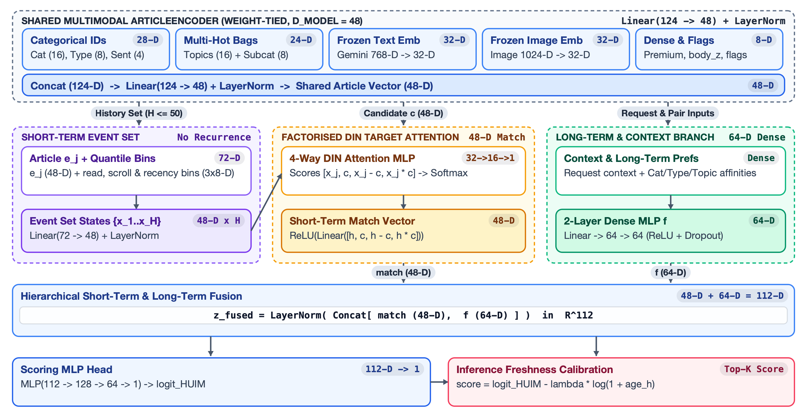
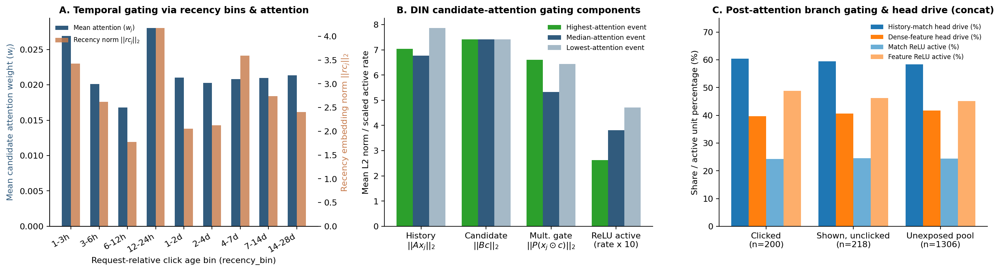

# 2.2 HUIM: Candidate-aware attention for relevance shortlisting

| Notebook | Purpose |
| --- | --- |
| [experiment.ipynb](experiment.ipynb) | Completed initial HUIM fit, catalogue exports and saved-model reload |
| [2.2.2_freshness_run.ipynb](2.2.2_freshness_run.ipynb) | Reload the frozen HUIM fit, tune freshness and export a new ranking recipe without retraining |
| [2.2.3_explainability.ipynb](2.2.3_explainability.ipynb) | Completed: 200 shared validation requests, 1,724 explanation pairs, attention and freshness examples, input sensitivity and report reload; findings included |

The initial all-request run `20261104_014752_seed42` and freshness continuation `20261104_234712_freshness_seed42` both completed all exports and passed persistent reload. Their executed outputs and findings are preserved in the respective notebooks.

For explainability, upload `huim_explainability_helpers.zip` to a fresh Colab
GPU / High RAM runtime and run `2.2.3_explainability.ipynb`. It uses 200 shared
validation requests and does not retrain or modify handoff files. Reports go to
`2.2.3_explainability/<run_id>/`; findings are detailed in [2.2.3_explainability.ipynb](2.2.3_explainability.ipynb).

## Neural Architecture and Formulation

The `HUIMStage1` model (defined in `huim/model.py`) is a Deep Interest Network (DIN) inspired ranker engineered for high-throughput candidate scoring. Unlike recurrent architectures, it operates without recurrence or sequence-positional encodings: the interaction history is processed in parallel, conditioned dynamically on candidate article features via multiplicative target attention.



### Order-Invariant Parallel Event Encoder
The shared article encoder maps metadata, category embeddings, subcategories, sentiment, and frozen text/image projections into a $d_{\text{model}} = 64$-dimensional article vector $e \in \mathbb{R}^{64}$. Each historical interaction event incorporates behavioral depth and temporal intervals:
- Read time bin embedding: 8-D learned representation from discrete dwell duration buckets.
- Scroll percentage bin embedding: 8-D learned representation from discrete scroll depth tiers.
- Request-relative recency bin embedding: 8-D learned representation capturing the elapsed time between historical reading and request timestamp.

The concatenated event vector of width 88-D (64 + 8 + 8 + 8 = 88) is projected through a dense linear transformation with Layer Normalization:

$$x_j = \text{LayerNorm}(W_{\text{ev}} [e_j \,\|\, b_{\text{read}} \,\|\, b_{\text{scroll}} \,\|\, b_{\text{rec}}] + b_{\text{ev}}) \in \mathbb{R}^{64}$$

Because temporal context is explicitly bound to each event vector, the sequence is permutation-invariant and scored in parallel across time steps.

### 10 Request-Relative Recency Bins
Temporal relevance is parameterized via 10 fixed logarithmic hour thresholds ($[1, 3, 6, 12, 24, 48, 96, 168, 336, 672]$ hours). Historical events are bucketed dynamically relative to each request timestamp $\Delta t = t_{\text{req}} - t_j$. This discretization enables parallel GPU execution across all historical items without sequential recurrent unrolling or causal masking overhead.

### DIN Multiplicative Candidate Attention
Given candidate article embedding $c \in \mathbb{R}^{64}$ and historical event representations $x_j \in \mathbb{R}^{64}$, the attention mechanism computes item-to-candidate alignment scores. The first interaction layer is formulated as:

$$a_j = W_{\text{out}} \text{ReLU}\left(A x_j + B c + P(x_j \odot c)\right)$$

where $A \in \mathbb{R}^{32 \times 64}$, $B \in \mathbb{R}^{32 \times 64}$, and $P \in \mathbb{R}^{32 \times 64}$. The product term $P(x_j \odot c)$ functions as a direct multiplicative interaction gate, allowing candidate attributes to activate or suppress specific reading history dimensions. Normalized attention weights are computed over valid history events:

$$\alpha_j = \frac{\exp(a_j)}{\sum_{k \in \mathcal{H}} \exp(a_k)}$$

The pooled user interest representation conditioned on candidate $c$ is:

$$h = \sum_{j \in \mathcal{H}} \alpha_j x_j \in \mathbb{R}^{64}$$

Users without prior interaction history receive a learned default parameter vector $h_{\emptyset} \in \mathbb{R}^{64}$.

### Post-Attention Match Projection with ReLU Sparsity
To capture both directional shift and affinity magnitude between candidate and user interest, the model constructs a 256-D matching vector concatenating four components:

$$m = [h \,\|\, c \,\|\, h - c \,\|\, h \odot c] \in \mathbb{R}^{256}$$

This vector is compressed to 64 dimensions through a linear layer with ReLU activation:

$$z_{\text{match}} = \text{ReLU}(W_m m + b_m) \in \mathbb{R}^{64}$$

The ReLU non-linearity enforces representational sparsity, pruning weakly correlated matching dimensions prior to head fusion.

### 112-D Head and Soft Freshness Decay
A separate contextual branch maps 48-D request and candidate tabular features (device type, request hour, user historical CTR, point-in-time publication delay) through a feature MLP into a 48-D context vector $f \in \mathbb{R}^{48}$. The fusion layer concatenates the 64-D match representation with the 48-D context:

$$z = \text{LayerNorm}([z_{\text{match}} \,\|\, f]) \in \mathbb{R}^{112}$$

The 112-D representation feeds into the final prediction MLP ($112 \to 128 \to 64 \to 1$) with dropout (0.2) to predict the uncalibrated click logit $\text{logit}(u, c)$.

During full catalogue ranking, soft freshness decay counters popularity bias:

$$s(u, c) = \text{logit}(u, c) - \lambda \ln(1 + \Delta t_{\text{hours}})$$

where $\lambda = 2.0$ balances historical topic affinity with breaking publication recency across the 20,738 article candidate pool.

### Non-Recurrent Gating Equivalents

The feed-forward HUIM network operates without recurrence or sequential cell states ($c_t$). While the architecture supports an optional sigmoid fusion gate when `fusion="gated"`, the validation-selected checkpoint (`20261104_234712_freshness_seed42`) selected `fusion="concat"` (`adapter.model.gate is None`). The model implements three analogous gating mechanisms audited across the 200 validation requests (8,579 history clicks and 1,724 explained candidate pairs):

- **Temporal Decay via Recency Bins:** Rather than relying on exponential decay across recurrent steps, each past interaction is assigned a 10-bin request-relative recency embedding ($rc_j$). Attention weights decay predictably as interaction age increases.
- **Engagement Gating via DIN Multiplicative Attention:** Reading duration and scroll depth embeddings modulate each event representation $x_j$. The candidate-interaction projection $P(x_j \odot c)$ functions as a multiplicative gate, contributing 27.8% of the total pre-activation attention magnitude.
- **Output Filtering via ReLU Sparsity:** Post-attention matching projections apply ReLU activation gating before concatenating with the dense feature branch into the scoring head. This produces 75.5% activation sparsity (24.5% active units), filtering out inactive matching dimensions prior to final scoring. The history-match pathway drives 58.7% of the head input magnitude, with dense contextual features contributing the remaining 41.3%.



## Run the freshness continuation in Colab

1. Open `2.2.2_freshness_run.ipynb` in a fresh **A100 GPU / High RAM** runtime.
2. Upload **`huim_freshness_helpers.zip`** to `/content`, leaving it zipped. This ZIP contains the new `huim_freshness.py` extension. The original `huim_helpers.zip` is not needed for this continuation.
3. Keep the live Drive shortcut to `BT4222 Shared Final Folder` under `MyDrive/Colab Notebooks` (or directly under `MyDrive`). Run all and authorise Drive. No settings changes are needed for the existing completed source run.
4. The notebook loads the initial run's own saved code, weights and preprocessing. It selects freshness on the shared 2,000-request validation sample, reports on the separate 5,000 requests and exports every request in validation, holdout and train, in that order.
5. Wait for the numerical reload check to report **`passed: True`**, then download the executed notebook. The full run stays in `Experiments/2.2_huim/2.2.2_freshness_run/<run_id>/` on shared Drive.

The new bundle preserves the original model and adds `model/score_recipe.json`, the freshness selection/trial history and all handoff artifacts. The working cutoff is 100; top 200 is the export buffer. Schema v5 exports a generic blended `score` without `click_probability`; recorded-slate diagnostics contain every original pair separately. The initial model uses the same generic-score export format with freshness weight zero.

The initial notebook runs one path: **12 Optuna trials -> apply the winning settings -> fit all recorded training requests -> restore the selected checkpoint -> export every request -> save and reload from shared Drive**.

Course connection: the implementation combines categorical embeddings, attention, feature interactions, dense networks and dropout/weight-decay regularisation. The complete HUIM-inspired architecture is an adaptation rather than a model taught as a whole in class.

## Model and business hypothesis

Readers have several interests. Candidate-conditioned attention over individual past clicks may protect relevant articles in a larger shortlist better than a single history average. This HUIM-inspired model combines metadata embeddings, frozen text/image vector projections, historical reading-depth/recency bins, target attention and a separate request/pair feature branch. It has no recurrence or positional encoding. The final fusion uses concatenation and LayerNorm.

Training uses the supplied recorded candidates: clicked = 1 and shown-unclicked = 0. No catalogue negatives are created. Fixed histories are never augmented with later clicks. Slate size/rank, future popularity totals and current/subsequent reading outcomes are excluded. The feature audit in the notebook documents the permitted inputs.

The business pipeline is **eligible catalogue -> genuine Stage 1 top 200 -> Stage 2 business reranking -> final five**. Offline click recovery is an engagement proxy; it does not establish retention or profit.

## Run in Colab

1. Open `experiment.ipynb` in a GPU runtime.
2. Upload `huim_helpers.zip` to `/content`. The ZIP contains the editable `huim/*.py` files and the shared `huim_freshness.py` ranker. Locally, keep the ZIP beside the notebook. No Git credentials are needed.
3. Create the Drive shortcut at `/content/drive/MyDrive/Colab Notebooks/BT4222 Shared Final Folder`.
4. Run the notebook from top to bottom. It mounts Drive, loads inputs once, runs Optuna, applies the winning parameters and fits the main model.
5. Read the actual trial count/states, checkpoint, stop reason, validation metrics and persistent reload result before reporting outcomes.

Results are saved to:

```text
DATA_ROOT/Experiments/2.2_huim/<YYYYMMDD_HHMMSS_seed42>/
```

Run IDs use Singapore time. A session-local working copy lives at `/content/huim_runs/<run_id>/`. The selected model, fitted preprocessing, feature names, ID mappings, code, selection declarations and training history are copied to Drive immediately after fitting, before catalogue export. Tuning histories/study snapshots are persisted after each trial; the complete run is copied and checked after export.

## Budgets and model selection

| Scope | Budget |
| --- | --- |
| Optuna | 12 trials, up to 2 epochs and 60,000 complete training requests per trial |
| Main training | All recorded training requests, up to 4 epochs |
| Validation selection | Fixed 100 validation requests, shared seed-42 hash rule |
| Selection interval | Every 300 optimiser steps and each epoch end |
| Export | Every request in train, validation and test; every eligible catalogue article is scored |

TPE samples learning rate, weight decay, dropout, model dimension and modality dropout. All trials use the same model seed (42) and training request prefix; only the seeded TPE search varies parameters. Median pruning uses intermediate Recall@100. Completed trials are ordered by Recall@100, then observed-click nDCG@100, then earlier trial. Failed/pruned trials stay in the history. The winning configuration is saved and applied before the main fit.

AdamW, gradient clipping and GPU mixed precision train the model on recorded-slate BCE. Early stopping and the learning-rate scheduler follow catalogue Recall@100. The selected checkpoint is restored and re-evaluated; exports use those weights.

**Selection remains K=100 while export K=200.** Recall is macro-averaged over requests with original known clicks. Missed/ineligible clicks stay in the denominator. Observed-click nDCG uses those same original clicks in its ideal, capped at K; zero observed gain for an unshown article is retrieval bookkeeping, never an observed non-click label. Exact checkpoint ties retain the earlier checkpoint.

Validation is reused for development selection. Recorded-slate AUC is diagnostic only. Exported validation reports Recall@100/200 and observed-click nDCG@100/200 separately from the 100-request selection sample. Project test labels are reserved for final evaluation and masked in this notebook. Training predictions are in-sample, not out-of-fold stacking inputs.

## Shared catalogue and request identity

Use `published_at_or_before_request_v1` for every split:

- Ordered union of `train_val/articles.parquet`, then `test/articles.parquet`; first source record per original article ID wins, including missing fields.
- Known publication time at or before request time; no recency/access cutoff or embedding-coverage filter.
- Vector sources follow the same first-record precedence; a later source never backfills a legitimately missing vector.
- Missing vectors use zero projection contributions plus explicit missingness flags. They do not exclude articles.
- Score the entire eligible pool for each request, using pair chunks and a running top-K. No sampled articles, injected clicks or exhaustive stored score matrix.

`behaviour_id = f"{user_id}:{impression_id}"` uses original integer IDs. Validation-selection and tuning request subsets use BLAKE2b-64 priority for `f"42:{split}:{behaviour_id}"`, ordered by priority then ID, and processed by timestamp/user/impression. All main training/export requests remain included.

Pool source order, duplicate precedence, catalogue fingerprint, request IDs/counts, eligible counts, exclusions and empty pools are saved. Legitimate missing vectors are distinguished from undecodable/malformed files. The vector reader uses PyArrow, with DuckDB/Polars fallbacks when available, coerces backend readers to a concrete Table and records its reader/dimensions/nulls/finite-value checks. Input preparation reads each vector source once.

## Parquet contract (v4)

| Path | Contents |
| --- | --- |
| `predictions/{split}/submission_article_scores.parquet` | Genuine retained top-200 pairs: `behaviour_id` string, `article_id` int64, 1-based integer `rank`, float32 `score`, float64 `click_probability` |
| `rankings/{split}/submission_top_200.parquet` | Exactly one row per request: `behaviour_id`, native `list<int64>` `article_ids`; `[]` for an empty pool |
| `diagnostics/recorded_slates/{split}_scores.parquet` | Every original shown candidate, including non-clicks and those outside the top 200, with IDs/logit/probability; labels joined separately |
| `diagnostics/catalogue/{split}_requests.parquet` | Request IDs/timestamps, eligible counts, shortlist lengths, eligibility exclusions, tie counts and retrieval bookkeeping |

Retain `min(200, eligible_count)` unique articles, ordered by descending score then ascending original article ID. Never merge the recorded slate or clicked IDs into this list. Keep `selection_k=100`, `export_k=200`, `shortlist_size=200`, `final_display_size=5` in the manifests. `score` is a BCE-model logit; its sigmoid is an **uncalibrated** click-probability estimate conditional on recorded-slate training, not catalogue CTR.

Parquet writes are compressed and bounded by request blocks. The running top-K merge is checked while chunk scores are available; persisted validation checks all retained rows for request coverage, IDs, eligibility, length, order, finite scores, probability semantics and pair/ranking agreement. Empty requests remain explicit. No exhaustive score file or second full-catalogue export replay is needed.

## Saved model and reuse

The run includes:

- `model/weights.pt`, `model/model_config.json`, `model/preprocessing.json`;
- `model/feature_dictionary.json`: ordered meaningful input names and categorical index-to-value maps;
- `model/article_ids.npy`: original article-ID row order;
- `model/code/huim/`: actual executed helper sources;
- `tuning/optuna_study.sqlite3`, `tuning/trials.csv`, `tuning/summary.json`, `tuning/tuned_config.json`;
- training history, selection/request scopes, run/export configuration, metrics, input manifest, actual dependency versions and `reload_check.json`;
- all three splits' retained scores, rankings and complete recorded-slate diagnostics.

`preprocessing.json` preserves fitted vocabularies, engagement/recency bins, cross-feature indexing and dense scaling. Do not refit these or guess feature labels from weights. Embedding dimensions are not interpretable word coefficients.

For later inference, add `<run>/model/code/` to the Python path and call `huim.persist.load_model(run_dir, device)`. Pass its returned preprocessor into `P.prepare_inputs(saved_config, data_root, pre=preprocessor)` with the same source artifacts. The final notebook verifies feature-name order, article-ID order and small recorded/catalogue logit batches loaded from the persistent copy within `1e-4`, without retraining.

Internal recovery helpers remain available for development, but the submitted notebook presents one final execution. Recovery checkpoints and selected inference artifacts have different roles; exact interruption recovery is not claimed for this final run.

## Later evaluation

The planned shared evaluation notebook loads these selected bundles without retraining. It will use saved histories and trials for learning/search plots, compare identical validation requests and pools, inspect representative recommendations and history/feature groups, and assess coverage, missing-vector effects, uncertainty and Stage 2 relevance/freshness/diversity/continuity trade-offs. Attention weights alone are not causal explanations. Keep test outcomes out of selection and reranker tuning.

Static/synthetic checks use `python3 -m unittest discover -s tests -v` from this directory. They do not run training or an Optuna search. Source ZIP regeneration includes the current `huim/*.py` files and `huim_freshness.py`.
