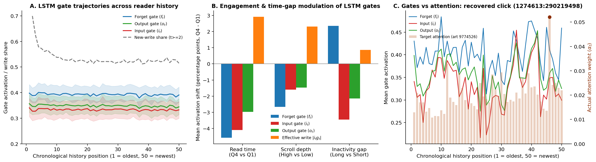
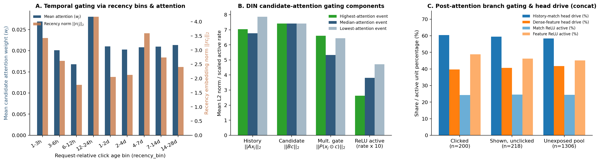

# Neural network explainability

These notebooks explain the two final scoring pipelines without training,
tuning, reranking, or changing their evaluator exports:

- [2.1.4 LSTM + freshness](../2.1_lstm/2.1.4_explainability.ipynb)
- [2.2.3 HUIM + freshness](../2.2_huim/2.2.3_explainability.ipynb)
- [Gate explainability analysis](gate_explainability_analysis.ipynb)

Both completed on an L4 GPU, with all cell outputs preserved and findings in
Section 9. Each explains the same 200 validation requests (179 readers) and
1,724 candidate pairs. Saved-score agreement and persistent report reload passed.
The report runs are `20261105_171932_seed42` (LSTM) and
`20261105_172058_seed42` (HUIM).
The source runs are pinned in `explain_common.MODEL_RUNS` to the completed final
LSTM and HUIM freshness bundles. Both source folders must be accessible through
the live shortcut to `BT4222 Shared Final Folder`.

In both models, metadata and the event-history pathway produced the largest
changes under the declared input replacements. Attention varied with the
candidate; deleting the highest-weight event changed scores more than deleting
the lowest-weight event for six of seven distinct LSTM case candidates and all
seven HUIM case candidates. These are local diagnostics, not causal effects or
evidence that one model's attention is better. Both models also placed a clicked
40-hour-old article outside the working top 100, illustrating the freshness
trade-off. The notebook findings discuss these cases and availability coverage;
the diagnostics do not change the evaluator's saved rankings.

## Empirical Gate Dynamics and Non-Recurrent Equivalents

The standalone companion notebook [`gate_explainability_analysis.ipynb`](gate_explainability_analysis.ipynb) loads and audits internal gating mechanics across both neural architectures (`2.1_lstm` and `2.2_huim`) on the shared 200 validation requests (8,579 verified interaction clicks, 1,724 candidate pairs).

### LSTM Recurrent Gate Dynamics

In the sequential Target-Aware LSTM (`nn.LSTM(128, 128)`), three sigmoid gates regulate how each chronological interaction updates and exposes the reader's state vector:

- **Forget Gate ($f_t$):** Controls the proportion of prior cell memory $c_{t-1}$ retained. Reading dwell time correlates negatively with forget gate activation ($r = -0.375$). When readers spend longer exploring an article, earlier context is discounted more heavily to assimilate new preferences. Conversely, longer inactive gaps between reading sessions correlate positively with forget activations ($r = +0.285$), preserving baseline interests across session breaks.
- **Input Gate ($i_t$):** Governs how strongly the current candidate interaction updates running memory. Dwell duration correlates positively with the effective memory write magnitude $|i_t \odot g_t|$ ($r = +0.294$).
- **Output Gate ($o_t$):** Regulates which cell memory dimensions are exposed in the hidden state $h_t$, dictating what information is visible to candidate-aware attention keys and the ranking head.
- **Numerical Parity:** Unrolling the saved weight matrices (`weight_ih_l0`, `weight_hh_l0`, `bias_ih_l0`, `bias_hh_l0`) matches the output of `adapter.model.encode_history` with numerical error below $10^{-5}$.



### HUIM Non-Recurrent Gating Equivalents

The feed-forward HUIM network operates without recurrence or sequential cell states ($c_t$). It replaces sequential LSTM gating with three explicit feed-forward mechanisms:

- **Temporal Decay via Recency Bins:** Rather than relying on exponential decay across recurrent steps, each past interaction is assigned a 10-bin request-relative recency embedding ($rc_j$). Attention weights decay predictably as interaction age increases.
- **Engagement Gating via DIN Multiplicative Attention:** Reading duration and scroll depth embeddings modulate each event representation $x_j$. The candidate-interaction projection $P(x_j \odot c)$ functions as a multiplicative gate, contributing 27.8% of the total pre-activation attention magnitude.
- **Output Filtering via ReLU Sparsity:** Post-attention matching projections apply ReLU activation gating before concatenating with the dense feature branch. This produces 75.5% activation sparsity, filtering out inactive matching dimensions prior to final scoring.



## Course grounding

The main explanation follows Week 8's target-aware LSTM `explain_predictions`
example: actual candidate-dependent attention, readable titles, and observed
outcomes. Week 11's confounding audit motivates checking those explanations.
The notebooks cite the original slides and supplied course notebook. Generated
notes were cross-checked; SHAP/LIME were named, not demonstrated in detail.

Exact freshness decomposition and grouped replacements are project adaptations.
Random-forest impurity importance from Week 12 is not applied to neural weights.
LSTM attention is over contextual prefix states; HUIM attention is over event
representations. Neither establishes causal preferences by itself.

## Run in Colab

1. Open the desired explanation notebook in a fresh GPU / High RAM runtime.
   L4 is sufficient; an existing A100 runtime uses the same code path.
2. Upload its matching `lstm_explainability_helpers.zip` or
   `huim_explainability_helpers.zip` to `/content`, leaving it zipped. Original
   training ZIPs are not needed: original model helpers come from the saved run.
3. Run all and authorise Drive. There are no training, smoke or method toggles.
4. Wait for **`Report saved and reloaded: True`** and download the executed
   notebook. No model weights or full prediction exports need downloading.

New reports go to the shared folder under:

- `Experiments/2.1_lstm/2.1.4_explainability/<run_id>/`
- `Experiments/2.2_huim/2.2.3_explainability/<run_id>/`

## Interpretation protocol

- The 200-request set uses seed 42, BLAKE2b-64 with salt
  `validation_explainability`, and hash-priority order. Its fingerprint is saved.
- Pairs are the union of both models' top3, rank100, within-buffer neural
  favourite and original known clicks. This conditional cohort is explanation
  data, not population-wide importance. Known clicked misses added here never
  alter the source shortlist. Unexposed outcomes remain unknown.
- Available baseline scores must reproduce the saved final scores within
  `1e-4`. The explicit age penalty is separated exactly and held fixed during
  neural sensitivity checks.
- Text/image replacement suppresses their representations and availability
  indicators together. Non-temporal metadata uses existing missing conventions.
  The device/account reference is the first sampled observed request, with clocks
  and profiles held fixed and subscriber crosses updated consistently.
- Event-pathway removal keeps separate profile aggregates fixed. Event deletion
  repacks aligned arrays and recomputes the LSTM sequence and time gaps; it is
  not a claim that every trace of an interaction has been erased.
- One-at-a-time score changes are non-additive reference sensitivities, not SHAP
  values or causal effects. Absolute score magnitudes are not compared across
  independently fitted models.
- Four illustrative rules select the first qualifying request in hash order:
  recovered click, missed click, model disagreement, and an ordering change
  induced by freshness within the saved buffer. Unavailable cases are omitted.
  No exact global rank is claimed for articles beyond the saved top200.
- Vector availability is audited for eligible pairs, saved top100 and observed
  clicks. Imbalance can confound explanations; it alone establishes neither
  leakage nor preferences for unshown articles.

## Saved outputs

The report contains `analysis_config.json`, cohort IDs, source fingerprints and
feature dictionary; named candidate/score/sensitivity tables; original attention
weights with aligned IDs in `attention_weights.npz`; readable history events,
case/removal tables, PNG figures, `findings.md`, and `report_reload_check.json`.
These support later inspection without retraining. Source model/preprocessing,
rankings and score files are read-only.

Shared logic lives in `explain_common.py` and `explain_report.py`; the model input
adapters live beside their respective notebooks. Each upload ZIP contains those
two shared helpers and its own adapter. The original saved model code remains
the authority for the neural forward pass and fitted transformations.

Small synthetic checks (no shared data or training):

```bash
MPLCONFIGDIR=/tmp/nn-explainability-mpl-cache python3 -m unittest discover -s Experiments/explainability -p test_explainability.py -v
```
