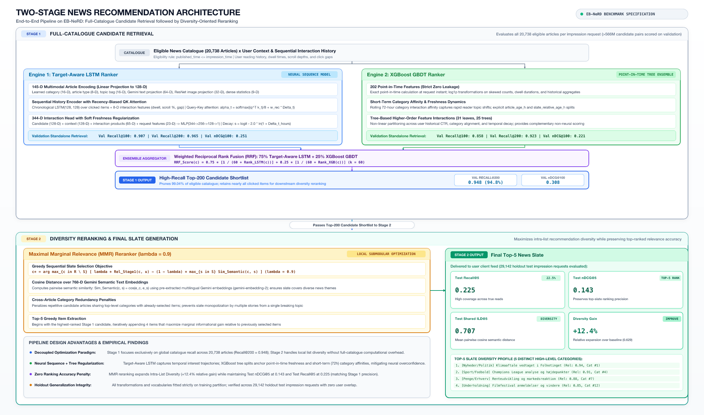

# Two-Stage News Recommendation Pipeline on EB-NeRD

## Abstract

This repository provides an end-to-end news recommendation framework developed and evaluated on the Ekstra Bladet News Recommendation Dataset (EB-NeRD Small). News recommendation poses distinctive operational challenges: user reading interests evolve across short temporal horizons, news catalogues experience rapid turnover, and production environments require low latency when serving personalised feeds.

To address these demands, the **Two-Stage Methodology (Stage 1: Full-Catalogue Candidate Retrieval -> Stage 2: Diversity Reranking)** serves as the core unifying framework applied throughout the entire project across all investigated model families:

1. **Stage 1 (Full-Catalogue Candidate Retrieval):** Evaluates every eligible article in the complete 20,738-article catalogue published prior to each impression request (scoring over 566 million candidate pairs on validation) to extract a high-recall top-200 shortlist. All candidate models across tabular gradient-boosted trees, sequential neural networks, and pretrained semantic representations were evaluated within this unified retrieval stage.
2. **Stage 2 (Diversity Reranking):** Takes the top-200 candidate shortlist from Stage 1 and applies diversity-aware reranking to balance recommendation relevance against topic redundancy, delivering the final top-5 recommendation slate for user presentation.

---

## System Architecture: Final Selected Submission Model

The overall two-stage system architecture below illustrates the **final selected submission model**, which demonstrated the highest ranking accuracy and intra-list diversity across validation and holdout test splits:



### Final Selected Model Overview

The final submission model integrates sequential neural modeling, gradient-boosted decision trees, and semantic diversity reranking:

- **Stage 1 (Full-Catalogue Retrieval Ensemble):**
  - **Full-Catalogue Scoring:** Every candidate article in the 20,738-article catalogue published prior to the request timestamp (`published_time <= impression_time`) is scored in parallel.
  - **Model Complementarity:** Retrieval combines the **Target-Aware LSTM** (capturing sequential reading dynamics and candidate-history attention) and the **XGBoost point-in-time ranker** (leveraging 202 engineered features including category affinities and dwell statistics). Both models apply logarithmic freshness regularization ($\lambda = 2.0$) to counteract historical popularity bias.
  - **Weighted Reciprocal Rank Fusion (RRF):** Individual model rankings are fused with 75% weight allocated to the Target-Aware LSTM and 25% weight to XGBoost:
    $$\text{RRF}(d) = 0.75 \cdot \frac{1}{60 + r_{\text{LSTM}}(d)} + 0.25 \cdot \frac{1}{60 + r_{\text{XGB}}(d)}$$
    The top-200 articles by fused score form the candidate shortlist for Stage 2.

- **Stage 2 (Diversity Reranking via MMR):**
  - **Relevance-Diversity Balancing:** The top-200 shortlist is reranked into the final 5-article recommendation slate using Maximal Marginal Relevance (MMR) with trade-off parameter $\lambda = 0.9$:
    $$\text{MMR}(u, c, S) = \lambda \cdot s(u, c) - (1 - \lambda) \max_{s \in S} \left(\text{Sim}_{\text{text}}(c, s) + \beta \cdot \mathbb{I}(\text{cat}_c = \text{cat}_s)\right)$$
  - **Semantic and Categorical Redundancy Penalties:** Semantic similarity $\text{Sim}_{\text{text}}$ is computed as the cosine similarity between frozen 768-dimensional multilingual Gemini text embeddings (`gemini-embedding-2`), while category overlap between candidate $c$ and selected articles $s \in S$ adds an explicit redundancy penalty ($\beta = 0.1$).
  - **Empirical Impact:** This stage delivers a 12.4% relative improvement in intra-list diversity (Shared ILD@5 increases from 0.629 to 0.707) while preserving top-5 ranking precision (Test nDCG@5 = 0.143, Test Recall@5 = 0.225).

### Evaluated Model Families

All candidate architectures explored during the project were systematically evaluated within Stage 1 retrieval:

- **Family 1 (Point-in-Time Tabular Rankers):** Baseline gradient-boosted decision trees and regularized linear models trained on 202 engineered features (interaction dwell time, category CTRs, rolling affinities, and item recency). See [`Experiments/1.1_lightgbm_ranker/`](Experiments/1.1_lightgbm_ranker/), [`Experiments/1.2_logistic_regression/`](Experiments/1.2_logistic_regression/), and [`Experiments/1.3_xgboost/`](Experiments/1.3_xgboost/).
- **Family 2 (Sequential Neural Rankers):**
  - **Target-Aware LSTM:** Encodes chronological click sequences using an LSTM recurrent backbone coupled with recency-biased query-key attention over multimodal candidate projections (Gemini text embeddings, ResNet image vectors, and categorical embeddings). Complete architectural schematics, mathematical formulations, and ablation benchmarks are documented in [`Experiments/2.1_lstm/`](Experiments/2.1_lstm/).
  - **Deep Interest Network / HUIM:** Implements non-recurrent candidate-aware attention (DIN multiplicative gating) across interaction history with request-relative recency binning and ReLU match projection sparsity. Full mathematical formulations, architecture diagrams, and freshness ablation studies are documented in [`Experiments/2.2_huim/`](Experiments/2.2_huim/).
  - **Interactive Architecture Viewer:** High-DPI canvas schematics detailing full tensor dimensions and layer topologies for both neural rankers are available in the interactive viewer at [`figures/neural_architecture_diagrams.html`](figures/neural_architecture_diagrams.html).
- **Family 3 (Pretrained Language Representations):** Unsupervised semantic similarity baselines matching user reading profiles against candidates using frozen multilingual Gemini embeddings and Danish DistilBERT representations. Documented in [`Experiments/3.1_pretrained_similarity_gemini/`](Experiments/3.1_pretrained_similarity_gemini/) and [`Experiments/3.2_pretrained_similarity_bert/`](Experiments/3.2_pretrained_similarity_bert/).

---

## Master Benchmark Results

All models were evaluated under identical catalogue retrieval conditions: scoring all 20,738 eligible articles per impression request across both the Validation split (29,110 requests, 566 million pairs evaluated) and the Holdout Test split (29,142 requests).

| Model / Stage | Architecture / Method | Val Recall@100 | Val Recall@200 | Val nDCG@100 | Val nDCG@200 | Test Recall@5 | Test nDCG@5 | Test Shared ILD@5 |
| :--- | :--- | :---: | :---: | :---: | :---: | :---: | :---: | :---: |
| **1.1 LightGBM** | GBDT Ranker (31 leaves, 75 trees) | 0.828 | 0.907 | 0.217 | 0.228 | - | - | - |
| **1.2 Logistic Regression** | Linear Baseline (C = 0.01) | 0.769 | 0.915 | 0.175 | 0.196 | - | - | - |
| **1.3 XGBoost** | GBDT Ranker (31 leaves, 25 trees) | 0.858 | 0.923 | 0.221 | 0.230 | 0.138 | 0.088 | 0.626 |
| **2.1 Target-Aware LSTM** | LSTM + Soft Freshness (lambda = 2.0) | 0.907 | 0.965 | 0.251 | 0.342 | 0.215 | 0.136 | 0.614 |
| **2.2 HUIM** | Parallel DIN Attention + Soft Freshness | 0.914 | 0.965 | 0.286 | 0.343 | - | - | - |
| **3.1 Gemini Semantic** | Multilingual Embeddings (`max_history`) | 0.032 | 0.048 | 0.006 | 0.009 | 0.017 | 0.010 | 0.768 |
| **3.2 DistilBERT** | Title+Subtitle+Intro Similarity | 0.015 | 0.025 | 0.003 | 0.004 | - | - | - |
| **Stage 1 Ensemble** | **Weighted RRF (75% LSTM + 25% XGBoost)** | **0.914** | **0.948** | **0.308** | **0.313** | **0.226** | **0.143** | 0.629 |
| **Stage 2 Reranker** | **MMR Diversity Rerank (lambda = 0.9)** | - | - | - | - | **0.225** | **0.143** | **0.707** (+12.4%) |

### Key Benchmark Observations

1. **Neural Superiority in Full-Catalogue Retrieval:** Target-Aware LSTM and HUIM reach 0.965 Recall@200, outperforming GBDT baselines (0.907 - 0.923). Target-conditioned attention over multimodal representations isolates relevant candidates across wide topic distributions.
2. **Failure of Pure Semantic Similarity:** Family 3 pretrained semantic models fail when applied directly to retrieval (Recall@100 of 0.015 - 0.032). Unsupervised semantic similarity overemphasizes textual proximity at the expense of timeliness and category affinity.
3. **Ensemble Complementarity:** Weighted RRF ensembling (75% LSTM + 25% XGBoost) yields the highest ranking precision on validation (nDCG@100 = 0.308) and test (nDCG@5 = 0.143, Recall@5 = 0.226). Point-in-time tree features provide regularizing signals that temper neural sequence overconfidence.
4. **Diversity Gains Without Ranking Degradation:** Stage 2 MMR reranking ($\lambda = 0.9$) increases Intra-List Diversity (ILD@5) from 0.629 to 0.707 (+12.4% relative improvement) while maintaining Test nDCG@5 at 0.143 and Test Recall@5 at 0.225.

---

## Model Explainability and Empirical Findings

The empirical explainability suite investigates how sequential neural networks and tree rankers process reading history and candidate articles across verified validation interactions. Rather than treating these architectures as opaque black boxes, the analysis examines internal gating dynamics, attention allocations, and global feature importance to extract three core conceptual takeaways:

1. **Memory Regulation:** Reader engagement actively modulates memory states. Articles read with longer dwell times induce deeper interest updates within recurrent cell states, whereas longer periods of inactivity between reading sessions trigger preservation of baseline interests rather than complete state overwrites. The non-recurrent HUIM network achieves comparable memory regulation through candidate-conditioned gating and high activation sparsity, selectively passing salient reading signals.
2. **Dynamic Candidate Filtering:** Candidate-queried attention in both recurrent (Target-Aware LSTM) and feed-forward (HUIM) architectures dynamically focuses on relevant past reading events while filtering out unrelated topical history. By conditioning historical event weights on the specific candidate article being evaluated, the model isolates thematic connections across disjoint reading sessions.
3. **Global Ranking Drivers:** Tabular tree rankers (XGBoost and LightGBM) rely primarily on article publication recency, short-term category affinity (e.g. 72-hour preferences), and historical reading frequency to determine recommendation ranks. Tree SHAP attributions and split gains confirm that freshness constraints and recent topical momentum dominate ranking decisions.

Readers interested in the exact unrolled gate distributions, correlation scatter plots, and empirical gating analysis are directed to the model explainability notebooks: [Experiments/2.1_lstm/2.1.4_explainability.ipynb](Experiments/2.1_lstm/2.1.4_explainability.ipynb) for recurrent LSTM gate dynamics, and [Experiments/2.2_huim/2.2.3_explainability.ipynb](Experiments/2.2_huim/2.2.3_explainability.ipynb) for non-recurrent gating equivalents.

---

## Dataset and Experimental Protocol

### Dataset Partitioning

The project utilizes the **EB-NeRD Small** dataset from Ekstra Bladet, containing anonymized reading behavior from Danish news readers. Interactions span consecutive 7-day observation periods in May and June 2023.

The evaluation protocol enforces a user-disjoint 80-10-10 split:
- **Training Set:** 232,887 impression requests (retaining original training interactions).
- **Validation Set:** 29,110 impression requests (sampled with seed 42 from the original validation period).
- **Holdout Test Set:** 29,142 impression requests (sampled with seed 43 from the original validation period, strictly excluding validation users).

All feature transformations, imputation statistics, and vocabulary mappings were fitted exclusively on the training partition to prevent information leakage.

### Full-Catalogue Candidate Generation

Unlike standard impression-slate evaluation, which ranks only recorded in-view articles (typically 5 to 30 items), this system performs full-catalogue retrieval:
- **Eligibility Rule (`published_at_or_before_request_v1`):** Every article in the 20,738-article catalogue whose publication timestamp satisfies `published_time <= impression_time` is scored.
- **Scale:** Validation scoring evaluates over 566 million request-candidate pairs. Unshown articles are treated as unobserved rather than negative candidates during inference.

### Evaluation Metrics

1. **Stage 1 (Retrieval):**
   - **Known-Click Recall@K ($K \in \{100, 200\}$):** Primary retrieval metric measuring the fraction of ground-truth clicked articles retrieved in the top-$K$ shortlist.
   - **Observed-Click nDCG@K ($K \in \{100, 200\}$):** Measures ranking quality of observed clicks within the retrieved shortlist.
2. **Stage 2 (Reranking):**
   - **Top-5 Relevance:** Recall@5 and nDCG@5 evaluated on the final 5-item slate.
   - **Shared Intra-List Diversity (ILD@5):** Mean pairwise cosine distance between 768-D Gemini embeddings of recommended articles:
     $$\text{ILD}(R) = \frac{2}{|R|(|R|-1)} \sum_{i < j} \left(1 - \cos(e_i, e_j)\right)$$
   - **Category Diversity:** Count of distinct high-level news categories present within the top-5 recommendation slate.

---

## Repository Organization

```
BT4222-Final-Project/
├── Preprocessing/                    # Split generation, EDA, feature engineering, and embeddings
│   ├── step1_val_test_split.ipynb    # User-disjoint 80-10-10 split construction
│   ├── step2_eda.ipynb               # Exploratory data analysis on EB-NeRD Small
│   ├── step3_feature_engineering.ipynb # 202-feature extraction pipeline (raw, log, scaled)
│   ├── embedding_pipeline.py         # Gemini text and EB-NeRD image vector processor
│   └── README.md                     # Data dictionaries and transformation documentation
├── Experiments/                      # Stage 1 model families and explainability suite
│   ├── 1.1_lightgbm_ranker/          # LightGBM GBDT ranker and full-split catalogue inference
│   ├── 1.2_logistic_regression/      # L2-regularized linear baseline
│   ├── 1.3_xgboost/                  # XGBoost GBDT ranker and Tree SHAP attribution
│   ├── 2.1_lstm/                     # Target-Aware LSTM ranker with soft freshness
│   ├── 2.2_huim/                     # Deep Interest Network (HUIM) with parallel attention
│   ├── 3.1_pretrained_similarity_gemini/ # Pretrained Gemini multilingual text similarity
│   ├── 3.2_pretrained_similarity_bert/   # Pretrained Danish DistilBERT text similarity
│   ├── 3.3_pretrained_retrieval/     # Pretrained contrastive retrieval pipeline
│   ├── 3.4_finetuned_distilbert/     # Domain fine-tuned DistilBERT bi-encoder
│   ├── 3.5_gemini_freshness/         # Gemini semantic similarity with freshness penalties
│   ├── 3.6_bert_intro_freshness/     # DistilBERT intro similarity with freshness penalties
│   ├── CONTRIBUTING.md               # Historical development standards and Optuna guidelines
│   └── README.md                     # Stage 1 retrieval experiments navigation guide
├── Cross Model Evaluation/           # Stage 1 ensembling and Stage 2 diversity reranking
│   ├── Step 1 Ensemble/              # Weighted RRF generation and weight grid search
│   ├── Step 2 Evaluation/            # Unified cross-model evaluation notebook
│   ├── Step 3 Reranking/             # Stage 2 MMR reranker and lambda grid search
│   ├── code/                         # Core evaluation, reranking, and metrics utilities
│   └── README.md                     # Reranking workflow documentation
└── figures/                          # System architecture diagrams and visualisations
    ├── system_architecture.png       # Two-stage system architecture flow diagram (final submission model)
    ├── final_lstm_architecture.svg   # Target-Aware LSTM architecture schematic
    ├── huim_architecture.png         # DIN / HUIM architecture schematic
    ├── neural_architecture_diagrams.html # Interactive high-DPI canvas viewer
    ├── lstm_gate_dynamics.png        # Unrolled LSTM gate correlation plots
    └── huim_gating_equivalents.png   # HUIM recency norms, DIN gates, and ReLU sparsity
```

---

## Google Drive Organization

The shared Google Drive folder (`BT4222 Shared Final Folder`) hosts large binary datasets, precomputed feature tables, neural embeddings, trained model weights, checkpoints, predictions, and candidate shortlists that exceed Git repository limits. The contents are organized as follows:

```
BT4222 Shared Final Folder/
├── train_val/                      # Raw EB-NeRD Small train and validation parquet splits
├── test/                           # Holdout test split parquet files (strictly masked during training)
├── feature_engineering/            # Engineered tabular matrices (raw, log, scaled) and text/image embeddings
│   ├── log_variants/               # Log-transformed numerical interaction features
│   ├── scaled_log_variants/        # Robust-scaled numerical features
│   └── text_embedding_variants/    # 768-D Gemini text vectors and 1024-D ResNet image vectors
├── Experiments/                    # Checkpoints, predictions, and top-200 shortlist exports per model
│   ├── 1.1_lightgbm_ranker/        # LightGBM booster bundles and full-split submission rankings
│   ├── 1.2_logistic_regression/    # Linear baseline weights and prediction files
│   ├── 1.3_xgboost/                # XGBoost models, top-200 rankings, and Tree SHAP artifacts
│   ├── 2.1_lstm/                   # Target-Aware LSTM weights, Optuna trials, and ranking exports
│   ├── 2.2_huim/                   # HUIM DIN model states, freshness configs, and prediction files
│   └── 3.x_pretrained_.../         # Gemini, DistilBERT, and freshness similarity score Parquets
└── Evaluation/                     # Stage 1 ensembling and Stage 2 diversity reranking artifacts
    ├── Stage 1/                    # Cross-model evaluation tables and metric summaries
    ├── Stage 2 - Reranking/        # MMR diversity grid search tables and lambda parameter selections
    └── ensemble/                   # Final fused 75:25 LSTM+XGBoost top-200 shortlist Parquets
```

### Google Colab Environment Setup

All training, inference, and evaluation notebooks are designed to execute in Google Colab environments by mounting Google Drive. Notebooks locate shared data tables, precomputed embeddings, and model checkpoints by mounting the shared storage root:

```python
from google.colab import drive
from pathlib import Path

drive.mount('/content/drive')
PROJECT_ROOT = Path('/content/drive/MyDrive/Colab Notebooks/BT4222 Shared Final Folder')
```

Relative paths inside the Drive folder directly parallel repository namespaces (`feature_engineering/` corresponds to `Preprocessing/`, `Experiments/` corresponds to `Experiments/`, and `Evaluation/` corresponds to `Cross Model Evaluation/`), ensuring modularity and reproducibility across execution environments.
